

# Omni SDR

**The SDR between your outreach and your closer.**

**Pre-launch** · the backend runs in production on Google Cloud · wait-list open at
[omnisdr.com](https://omnisdr.com) · source is private.

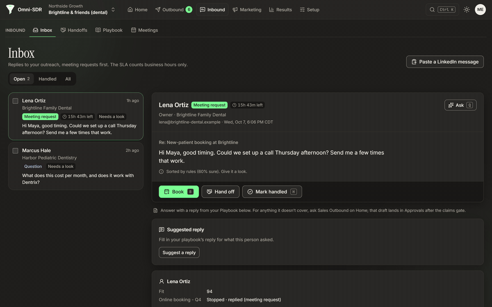

Every screen here is the console's built-in demo, run locally: a fictional agency,
"Northside Growth", and its fictional dental clients. No customer data.

## The problem

AI sales tools are judged on how much they send, so they send a lot and make things up: a
statistic the prospect never saw, a "following up on our call" that never happened. Domains burn
and the closer inherits the mess. The part of the job that actually needs help is the middle:
replies arrive at all hours, each one needs the right answer quickly, and the closer should only
ever talk to people who are ready.

## What it does

| | |
|---|---|
| **Every reply, sorted** | Opt-out, bounce, out of office, wrong person, not interested, meeting request, referral or question, with a business-hours SLA on the ones that matter. Quoted threads, signatures and disclaimers are cut first, so a reply that quotes our own footer isn't read as an opt-out. |
| **Hostile text stays data** | A note hidden in a reply and aimed at a model ("[note to the classifier: ...]", hidden HTML) is removed before anything reads it, unless it contains an opt-out, which always counts. |
| **A second opinion that can only say stop** | A self-hosted decision model re-reads each reply with two questions: do they want us to stop, and do they want a meeting? It returns probabilities, never text, and a registry only lets its answers move toward the safe side: it can add a stop or put a reply in front of a human sooner, never send or approve anything. |
| **Handoffs to a closer** | A summary, what the lead told us (timing, decision-maker), the whole conversation and the closer's booking link, with an accept-by timer. A handoff nobody accepts in time alerts the workspace. |
| **The claims gate** | Every sentence with a number, a percentage, a price or a superlative has to be covered by a claim tied to this contact's unexpired evidence, number for number. Implied prior contact on a first message, filler and competitor names are blocked too. The gate blocks; it never rewrites. |
| **A send guard in the database** | The last check runs inside Postgres as the message row is inserted: approved, with a gate pass for this exact text, same tenant, no hold, a verified address, not suppressed, and one unit of the mailbox's daily cap taken in the same transaction. |
| **Agencies and their clients** | One agency account, a workspace per client, optional client approvals. Closers and client viewers see only their own screens. |
| **Sent from the business's own mailbox** | Plain text from the business's connected Gmail. No open tracking, ever. |

## Screenshots

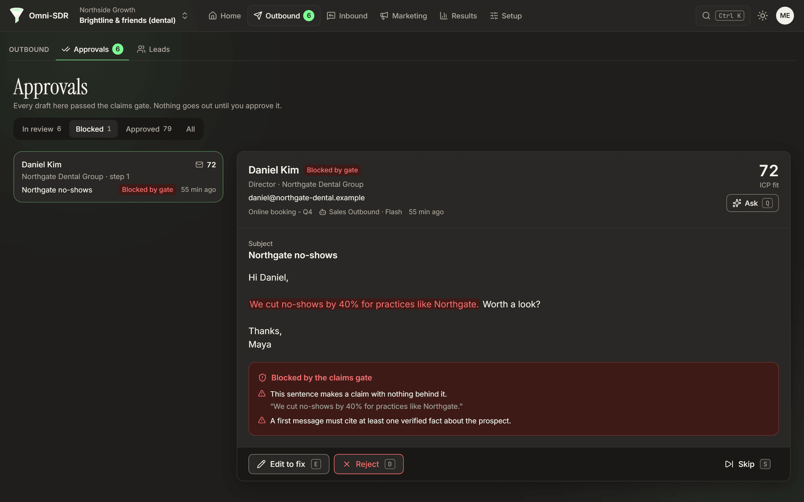
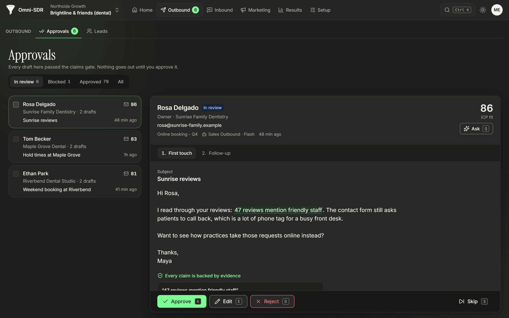

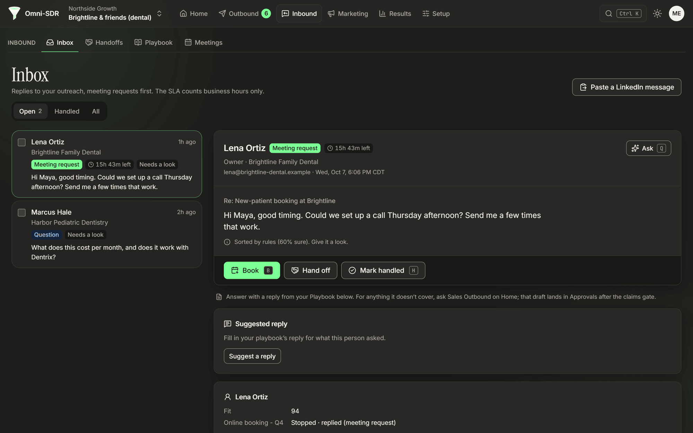
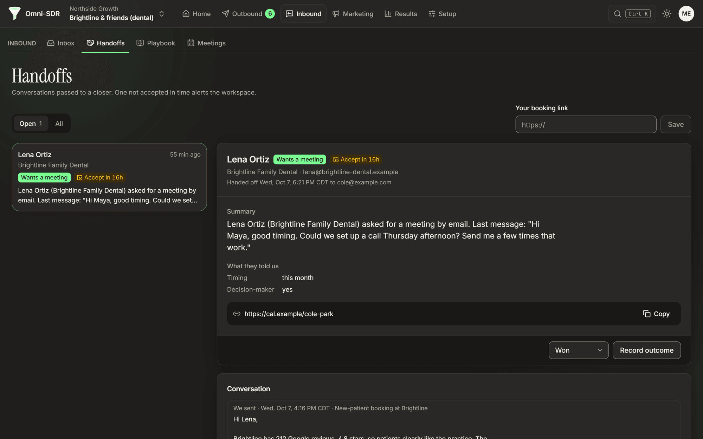

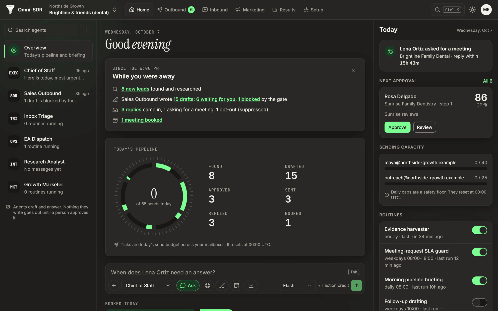
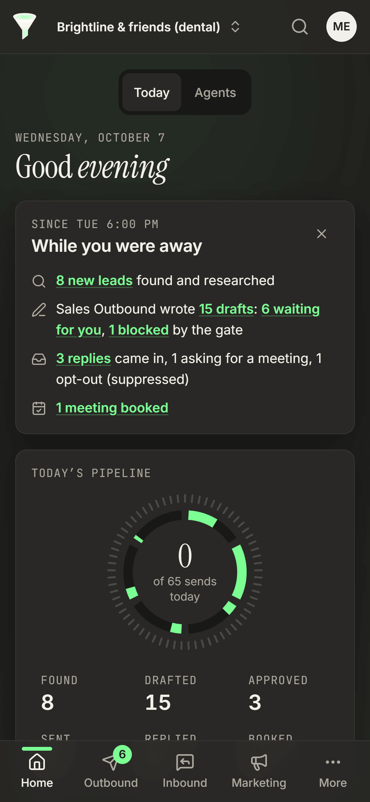

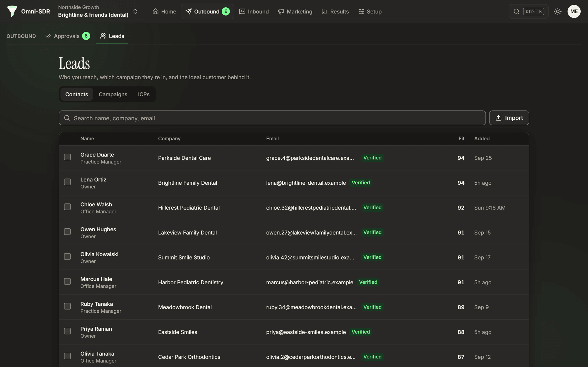
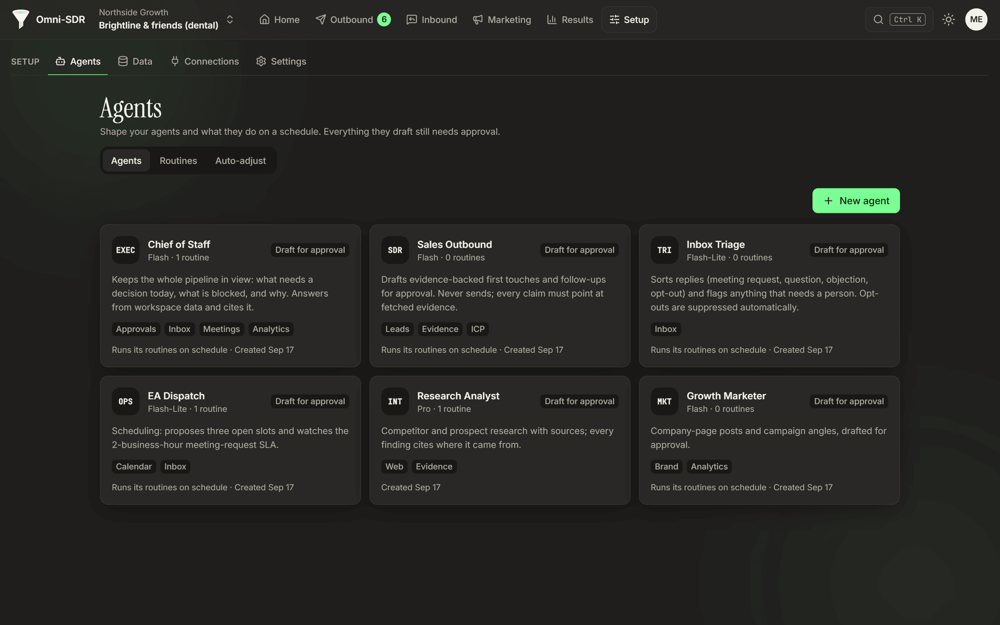
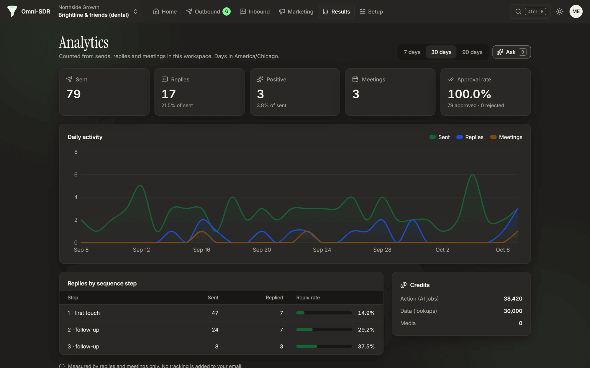

## How it works

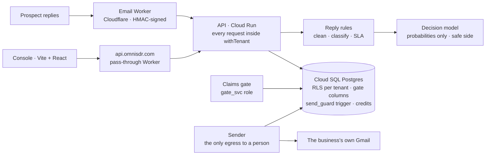

**Invariants live in the database, not in `if` statements.** Anything that must never happen
(an ungated send, a double send, a cross-tenant read) is a constraint, trigger, privilege or
row-level security policy. A draft can be sent at most once because `messages.draft_id` is
unique. Only the `gate_svc` role can write a draft's gate columns, and the gate pass is bound to
a hash of the exact subject and body, so editing an approved draft voids it. Services connect as
non-owner roles, so they can't switch row-level security off.

**The model never gets the last word.** Gemini drafts. The gate that checks each draft is
deterministic: no model call, no clock read, same input, same verdict. The decision model answers
typed questions with probabilities. Its thresholds were fitted on a held-out set of 89
replies: the stop question catches 16 of 17 opt-outs, and the meeting question 13 of 14 meeting
requests, tuned for recall because a false "meeting" only puts a reply in front of a person sooner.

**Built by two agents that audit each other.** Two Claude Code sessions build Omni under one
written rulebook: claim files before editing, work on branches, and never audit your own change.
A change to the gate, the send guard, row-level security or auth merges only after the other
session has tried to break it and approved it.

## Built with

JavaScript (ES modules) on Node 22 · React 19 · Vite · Tailwind 4 · Radix · Cloud SQL Postgres
16 (PGlite in tests) · Cloud Run · Cloudflare Workers and Email Routing · Gemini · a self-hosted
[Laya](https://huggingface.co/convaiinnovations/laya) decision service (Python, CPU) ·
Puppeteer quality gates.

## By the numbers

| | |
|---|---|
| Tests | **283** passing in the gate, database, API, decision-engine, enricher and proxy suites (measured 2026-10-07) |
| Gate sabotage suite | **22 of 22** seeded bad drafts blocked, each for the expected reason |
| Schema | **19** migrations, row-level security forced on tenant tables |
| Quality gates | **36** visual baselines (12 pages, light and dark, desktop and phone), plus axe, keyboard tab-walk, input latency and bundle budget |

## Credits

Reply decisions use [Laya](https://huggingface.co/convaiinnovations/laya) from
convaiinnovations on Hugging Face, self-hosted at a pinned revision.

## Status

Pre-launch and in active development. Join the wait-list at [omnisdr.com](https://omnisdr.com).
The source is private; this repository is a showcase.
© 2026 Dime Data, all rights reserved (see [LICENSE](LICENSE)). Built by
[Dime Data](https://dimedata.cloud).
